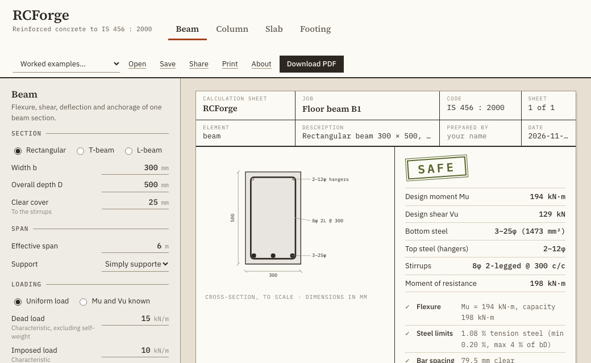
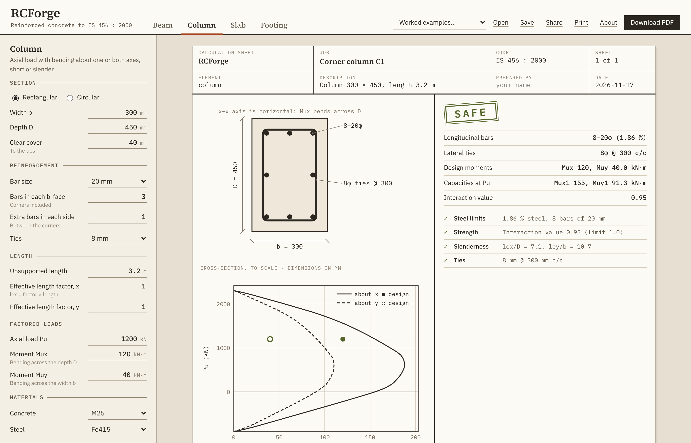
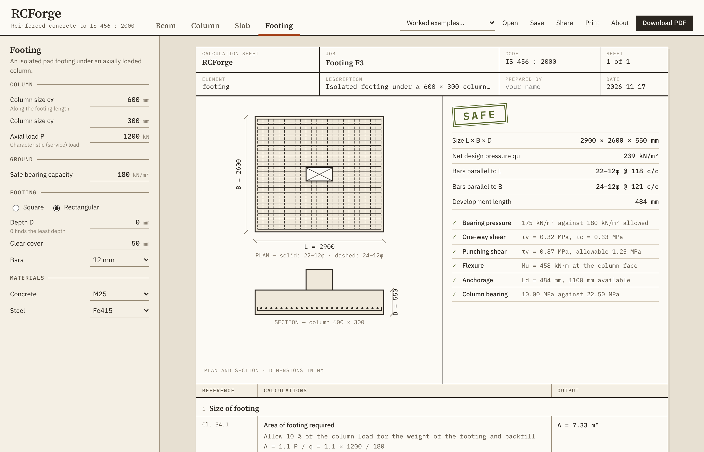
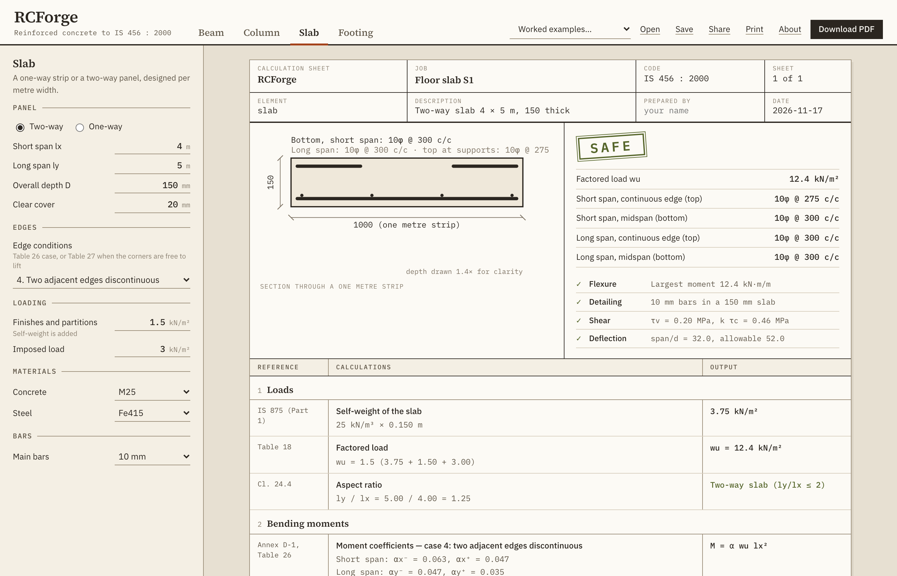
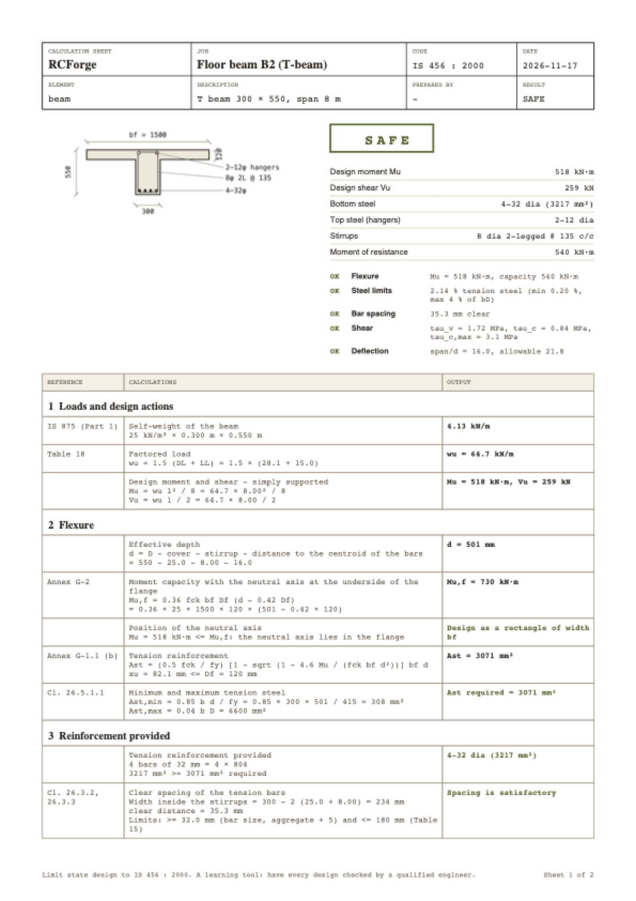
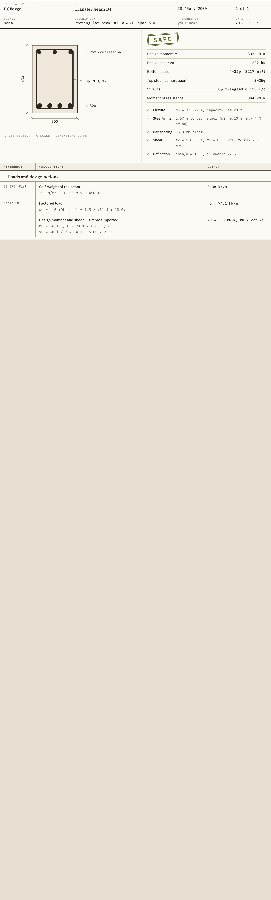
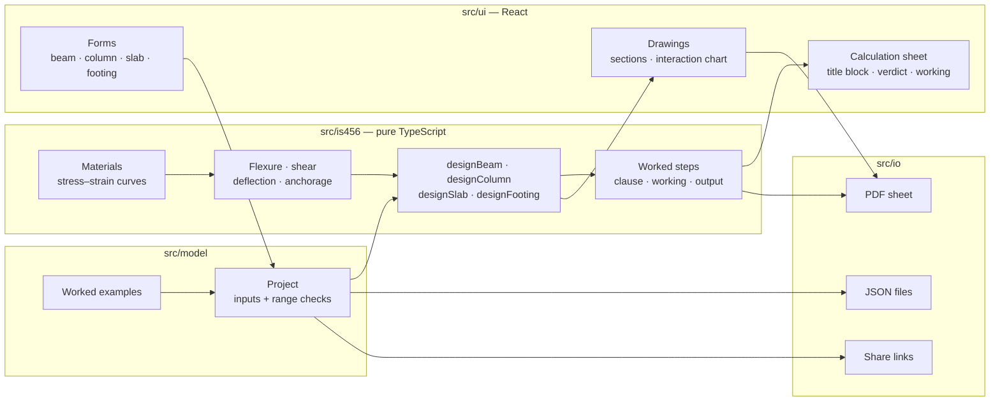

<div align="center">

# RCForge

**Reinforced concrete design to IS 456 : 2000, set out like a hand calculation.**

Beams, columns, slabs and footings — every step shown with its clause, the working and the result,
in your browser. No install, no licence, nothing uploaded.

### [Open RCForge](https://wrucebayne29.github.io/rcforge/)

[](https://github.com/WruceBayne29/rcforge/actions/workflows/ci.yml)
[](https://github.com/WruceBayne29/rcforge/actions/workflows/deploy.yml)
[](LICENSE)



</div>

## Why

Design software gives you an answer. A course in reinforced concrete asks you to show how you got
it. RCForge does the design **and writes out the calculation**, in the three columns every
engineering office uses: the clause on the left, the working in the middle, the figure you carry
forward on the right. Change an input and the whole sheet recalculates, so you can see which line
moved and why.

It is the concrete counterpart of [FrameForge](https://github.com/WruceBayne29/frameforge), which
analyses steel frames and trusses.

## What it designs

**Beams**

- Rectangular, T and L sections; simply supported, continuous or cantilever
- Singly and doubly reinforced flexure (Annex G), with the neutral axis found by strain
  compatibility when checking capacity
- Bars chosen to fit the width, in one layer where possible
- Shear with vertical stirrups (cl. 40), deflection by span/depth with all modification factors
  (cl. 23.2.1), development length (cl. 26.2), minimum and maximum steel, bar spacing

**Columns**

- Rectangular and circular, short or slender, with axial load and bending about one or both axes
- P–M interaction diagrams computed from first principles for the actual bar layout
- Minimum eccentricity, additional moments for slenderness (cl. 39.7.1), biaxial check (cl. 39.6),
  lateral ties

**Slabs**

- One-way slabs with the Table 12 / 13 coefficients
- Two-way slabs: all nine restrained cases of Table 26, and Table 27 for corners free to lift
- Steel in both directions and at continuous edges, shear with the slab factor, deflection

**Footings**

- Isolated square and rectangular pads: sizing from bearing capacity, one-way and punching
  shear, flexure, anchorage and bearing under the column
- Finds the least depth that works, or checks the depth you give

**For every element**

- A to-scale drawing of the section with the bars as designed
- An indicative bar bending schedule with cutting lengths and weights
- A PDF calculation sheet, JSON save and open, and a link that reopens the exact design
- Eleven worked examples

## Screenshots

| Column with its interaction diagram | Footing, plan and section |
| --- | --- |
|  |  |

| Two-way slab | PDF calculation sheet |
| --- | --- |
|  |  |

<details>
<summary>A complete sheet, top to bottom</summary>



</details>

## Quick start

```bash
git clone https://github.com/WruceBayne29/rcforge.git
cd rcforge
npm install
npm run dev
```

| Command | What it does |
| --- | --- |
| `npm run dev` | Start the app with hot reload |
| `npm test` | Unit tests and the validation suite |
| `npm run check` | Lint, tests and a production build |
| `npm run validation` | Regenerate `VALIDATION.md` |
| `npm run e2e` | Playwright script that uses every feature of the live site |

## The method in brief

Limit state design: the section must resist the factored loads with the materials at their design
strengths, $0.446 f_{ck}$ for concrete and $0.87 f_y$ for steel.

**Flexure.** Concrete in compression is represented by a stress block of area
$0.36 f_{ck} b x_u$ acting at $0.42 x_u$. Equilibrium with the tension steel gives

$$ M_u = 0.87 f_y A_{st}\, d \left(1 - \frac{A_{st} f_y}{b\, d\, f_{ck}}\right) $$

and the neutral axis may not go deeper than $x_{u,max}$ ($0.48d$ for Fe415), which caps the moment
at $M_{u,lim} = 0.138 f_{ck} b d^2$. Beyond that, compression steel is added.

**Shear.** $\tau_v = V_u / (b d)$ is compared with the concrete's strength $\tau_c$ (which rises
with the tension steel); stirrups carry the difference:

$$ s_v = \frac{0.87 f_y A_{sv}\, d}{V_u - \tau_c b d} $$

**Columns.** For any neutral axis depth the strain across the section is known, so the stress in
the concrete and in every bar follows from the material curves. Integrating gives one point
$(P_u, M_u)$; sweeping the neutral axis gives the interaction diagram. Bending about two axes is
checked with

$$ \left(\frac{M_{ux}}{M_{ux1}}\right)^{\alpha_n} + \left(\frac{M_{uy}}{M_{uy1}}\right)^{\alpha_n} \le 1 $$

**Footings.** Sized on the service load, then checked at three critical sections: bending at the
column face, beam shear at $d$ from it, and punching shear at $d/2$ around it.

The full derivations, clause by clause, are in **[docs/THEORY.md](docs/THEORY.md)**.

## Validation

The engine is checked against values printed in IS 456 and SP 16, closed-form identities and
cross-checks between independent routines. The table is generated by the test suite
(`npm run validation`); the complete results, and an honest list of what is **not** independently
verified, are in **[VALIDATION.md](VALIDATION.md)**.

<!-- validation:start -->
**75 values in 14 groups.**

| # | What is checked | Source | Basis | Values |
| --- | --- | --- | --- | ---: |
| V01 | Limiting neutral axis depth xu,max / d | IS 456 cl. 38.1 (note) | published | 3 |
| V02 | Limiting moment coefficient Mu,lim / (fck b d²) | IS 456 Annex G-1.1 (c); SP 16 Table C | published | 3 |
| V03 | Limiting percentage of tension steel pt,lim | SP 16 Table E | published | 6 |
| V04 | Design stress–strain curve of cold-worked bars | IS 456 Fig. 23A; SP 16 Table A | published | 8 |
| V05 | Design shear strength of concrete τc | IS 456 Table 19 | published | 11 |
| V06 | Development length in bar diameters | IS 456 cl. 26.2.1; SP 16 Table 65 | published | 6 |
| V07 | Minimum tension steel in beams, 100 As / (b d) = 85 / fy | IS 456 cl. 26.5.1.1 | closed form | 3 |
| V08 | Two-way slab coefficients, simply supported with corners free to lift | IS 456 Table 27 | published | 10 |
| V09 | Two-way restrained slab coefficients, square panels | IS 456 Table 26; positive αy = (24 + 2 Nd + 1.5 Nd²) / 1000 | cross-check | 6 |
| V10 | Concrete stress block from the parabolic–rectangular curve | IS 456 Fig. 21, 22: 0.36 fck xu acting at 0.42 xu | closed form | 3 |
| V11 | Design then analysis returns the design moment | Annex G-1.1 formula against the stress block (rounded independently in the code) | cross-check | 3 |
| V12 | Column section limits | IS 456 cl. 39.1; statics | closed form | 4 |
| V13 | Biaxial interaction exponent αn | IS 456 cl. 39.6 | published | 3 |
| V14 | Deflection modification factors | IS 456 Fig. 4 and Fig. 5 (values read from the curves) | published | 6 |
<!-- validation:end -->

## Architecture

The calculations know nothing about the interface. Every design routine returns its numbers
together with the steps that produced them, and the sheet, the PDF and the tests all read the
same steps.



```
src/
  is456/     the calculations: one file per topic, each returning results and worked steps
  model/     the project document, input checks, worked examples
  io/        JSON files, share links, PDF calculation sheet
  ui/        forms, the sheet, drawings
tests/validation/   published values the engine must reproduce
scripts/     Playwright end-to-end and screenshot scripts
docs/        THEORY.md, screenshots
```

Strict TypeScript with no `any`, ESLint and Prettier clean, coverage thresholds enforced in CI.

## Limits

RCForge designs one section at a time; it does not analyse a structure. It uses the single load
combination 1.5 (DL + LL) and leaves out torsion, crack width calculation, moment redistribution,
ductile detailing to IS 13920, flat slabs and combined footings. The bar schedule is indicative.

It is a learning tool. Have every design checked by a qualified engineer before it is built.

## Roadmap

- [x] Beams, columns, slabs and footings with worked steps
- [x] Section drawings, interaction diagrams, bar schedules
- [x] PDF sheet, JSON and share links
- [ ] Staircases and retaining walls
- [ ] Load combinations with wind and earthquake (IS 875, IS 1893)
- [ ] Ductile detailing checks to IS 13920
- [ ] Longitudinal section with bar curtailment
- [ ] Taking beam and column forces straight from a FrameForge analysis

## Contributing

See [CONTRIBUTING.md](CONTRIBUTING.md). If a number is wrong, please open a "Wrong result" issue
with the share link and the value you expected; that is the most useful report there is.

## License

[MIT](LICENSE)
